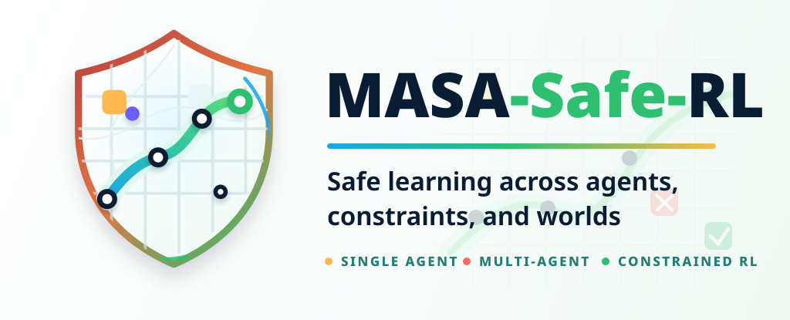

# MASA-Safe-RL


[](https://pypi.org/project/MASA-Safe-RL/)
[](https://doi.org/10.5281/zenodo.24396240)
[](https://sacktock.github.io/MASA-Safe-RL)
[](LICENSE)

[View Documentation](https://sacktock.github.io/MASA-Safe-RL)

______________________________________________________________________

MASA-Safe-RL (Multi- and Single-Agent Safe RL) is a modular library for safe reinforcement learning, built on the [Gymnasium](https://gymnasium.farama.org/) and [PettingZoo](https://pettingzoo.farama.org/) interfaces. You supply an environment plus a labelling function and a cost function. MASA wraps the environment in a stateful constraint monitor and, optionally, a shield, and trains it with algorithm-agnostic learners. Safety specifications live outside the environment, so the same environment can be evaluated under different constraints without modification.

- **Constraints:** CMDPs, constrained Markov games (per-coalition budgets), LTL safety (DFA), PCTL, probabilistic safety and reach-avoid.
- **Shielding:** deterministic shields from LTL safety games (preemptive or post-posed, including coalitional shields for multi-agent settings) and probabilistic shielding.
- **Algorithms:** tabular safe RL baselines; JAX implementations of PPO, A2C, TRPO, CPO and Lagrangian variants; and multi-agent independent Q-learning variants.
- **Environments:** 35 single- and multi-agent benchmarks, from gridworlds and matrix games to continuous control.
- **Tooling:** a `masa` command-line interface, TensorBoard and W&B logging, plotting utilities and [tutorial notebooks](notebooks/tutorials).

MASA-Safe-RL is under active development (pre-1.0), so APIs may still change. We'd love to hear what you'd like to see implemented; see [Getting in Touch](#getting-in-touch).

## Citing MASA-Safe-RL

If you use MASA-Safe-RL in your research please cite our release archive on Zenodo. The DOI here resolves the latest release, if you want to cite a specific version please see each release's own version DOI on its Zenodo page.

```bibtex
@software{goodall2026masa,
  author    = {Goodall, Alexander W. and Adalat, Omar and {Hamel-De le Court}, Edwin and Belardinelli, Francesco},
  title     = {{MASA-Safe-RL}: A Modular Library for Single- and Multi-Agent Safe Reinforcement Learning},
  year      = {2026},
  publisher = {Zenodo},
  doi       = {10.5281/zenodo.24396240},
  url       = {https://doi.org/10.5281/zenodo.24396240}
}
```

## Quick Start

### Installation

#### Prequisites

Python 3.12+ is required (3.13 recommended).

#### Installation with conda

- Install conda, e.g., via [anaconda](https://anaconda.org/channels/anaconda/packages/conda/overview).
- Clone the repo:

```bash
git clone https://github.com/sacktock/MASA-Safe-RL.git
cd MASA-Safe-RL
```

- Create a conda virtual environment:

```bash
conda env create --name masa --file conda-environment.yaml
conda activate masa
```

- Install dependencies:

```bash
pip install -e .
```

#### Installation with uv

`uv sync` installs only base dependency package from the repository root.

**Easiest way to install all dependencies:** All dependency groups (docs and GPU support for CUDA13): `uv sync --all-groups --no-group cuda12`.

Alternatively, `uv sync --all-groups --no-group cuda13` if your system only supports CUDA 12.

More minimal ways of installing dependency groups:

- For building docs, use `uv sync --group docs` from the repository root.
- Adding GPU support for Jax: `uv sync --group cuda13` (or `cuda12` if CUDA 13 is not supported by your device)

#### Installation with PyPI

MASA-Safe-RL is now available on PyPI: [MASA-Safe-RL](https://pypi.org/project/MASA-Safe-RL/).

```bash
pip install -U MASA-Safe-RL
```

### Enabling GPU Acceleration with JAX (Optional)

MASA-Safe-RL relies on [JAX](https://docs.jax.dev/) for GPU acceleration. If you are only interested in the gymnasium wrappers and constraints API then you do not need to complete the following steps.

## Mac and Windows

**macOS** and **Windows**: we recommend JAX with CPU. No further action is required if you correctly followed the earlier steps.

#### pip

- **Linux x86_64/aarch64** and **Windows WSL2 x86_64**: We strongly recommend using [Ubuntu 22.04](https://apps.microsoft.com/detail/9pn20msr04dw?hl=en-GB&gl=BE) or similar, jax and jaxlib should already be installed. You need to reinstall [JAX](https://docs.jax.dev/) based on your cuda driver compatibility. Do not use the `-U` option here as it may break earlier dependencies!

```bash
pip install "jax[cuda13]"
```

```bash
pip install "jax[cuda12]"
```

#### uv

Alternatively with `uv`,

```bash
uv sync --group cuda12
```

```bash
uv sync --group cuda13
```

## How to run MASA

- You can run masa with the prebuilt CLI:

```bash
masa run --env-id bridge_crossing --algo ppo --seed 0
```

- You can run examples from the `\examples` folder via:

```bash
masa example prob_shield_example
```

## Editing documentation

Documentation uses the root `pyproject.toml` and `uv.lock`, so you can build and serve it directly from the repository root.

```bash
uv run zensical build --strict
```

The built site will be available at `site/index.html`.

For live reload while editing, run:

```bash
uv run zensical serve
```

## Local storage

The project currently uses the following directories for local storage:

- `.cache/` - for persisting transition matrices to avoid recomputation
- `videos/` - stores recorded videos from training runs at configured intervals or played runs using notebooks/
- `runs/` - persisted data and metrics of training runs
- `benchmarks/` - stores results from `masa benchmark` runs

## Contributing

We use [`pre-commit`](https://pre-commit.com/) for formatting and linting (Ruff, yamlfmt, taplo, mdformat, plus local checks). Install the git hook once per clone:

```bash
pip install pre-commit   # or: uv tool install pre-commit
pre-commit install
```

It then runs automatically on every `git commit` (run manually with `pre-commit run --all-files`). CI runs the same pinned hooks on changed files via `pre-commit/action`, alongside the test suite.

## Getting in Touch

MASA-Safe-RL is primarliy managed by [Alex Goodall](https://github.com/sacktock) and [Omar Adalat](https://github.com/nightly). For correspondence in the early stages of the library we prefer you contact us directly via email (a.goodall22@imperial.ac.uk & o.adalat24@imperial.ac.uk), rather than raising issues on GitHub directly.

## License

MASA-Safe-RL is released under Apache License 2.0.
